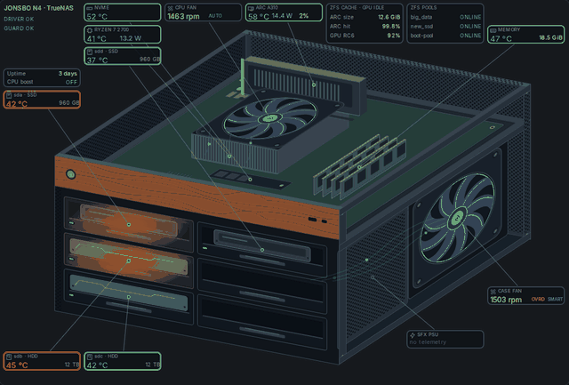
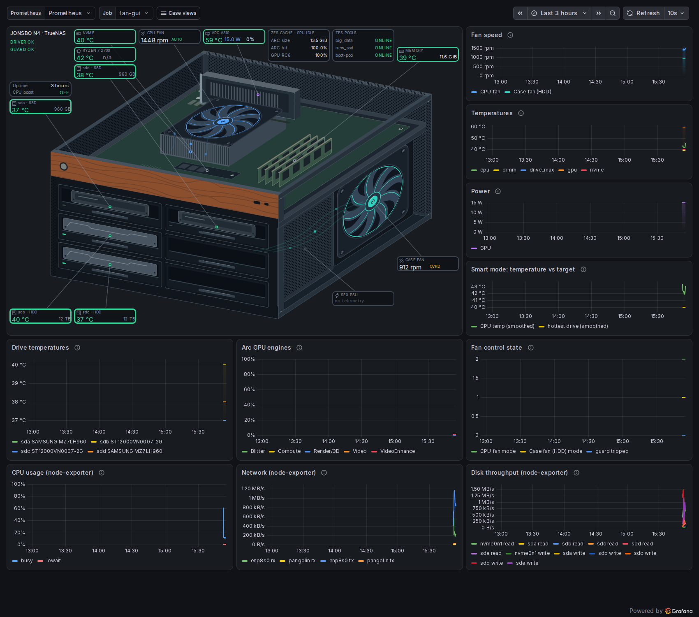
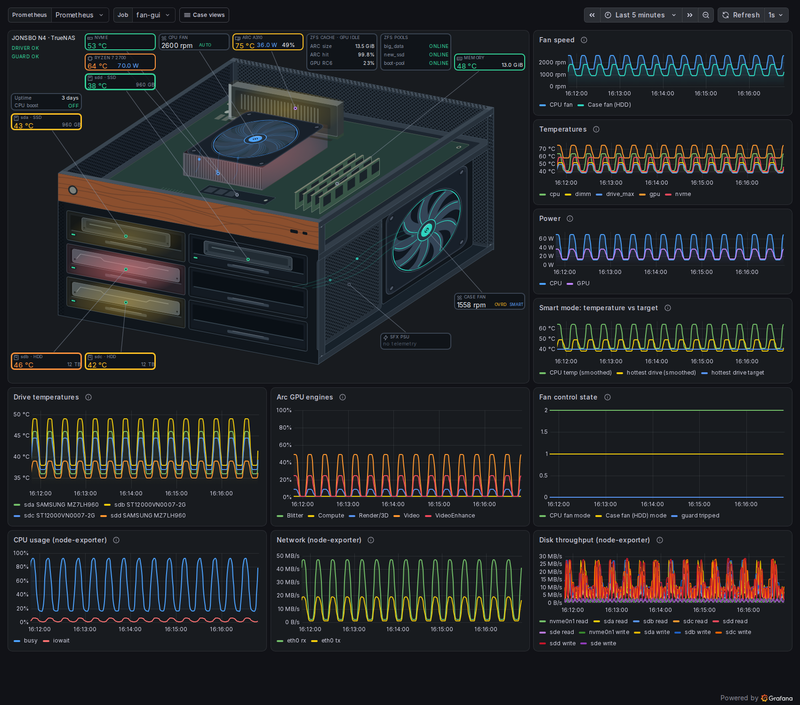
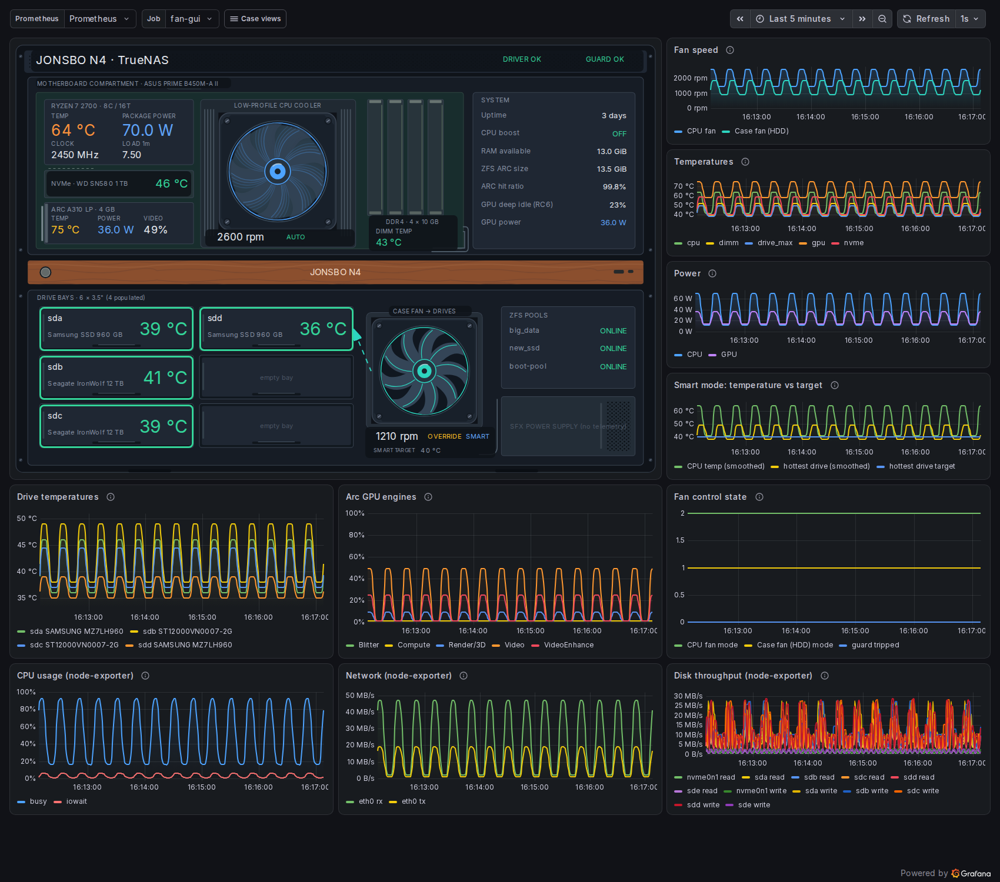
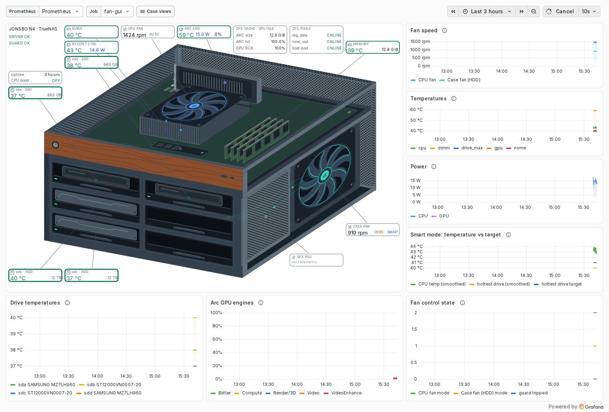
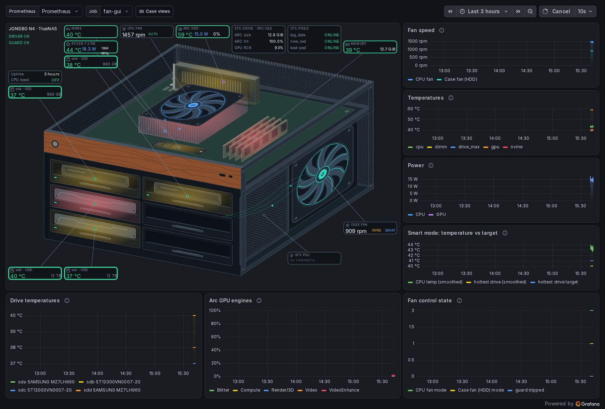
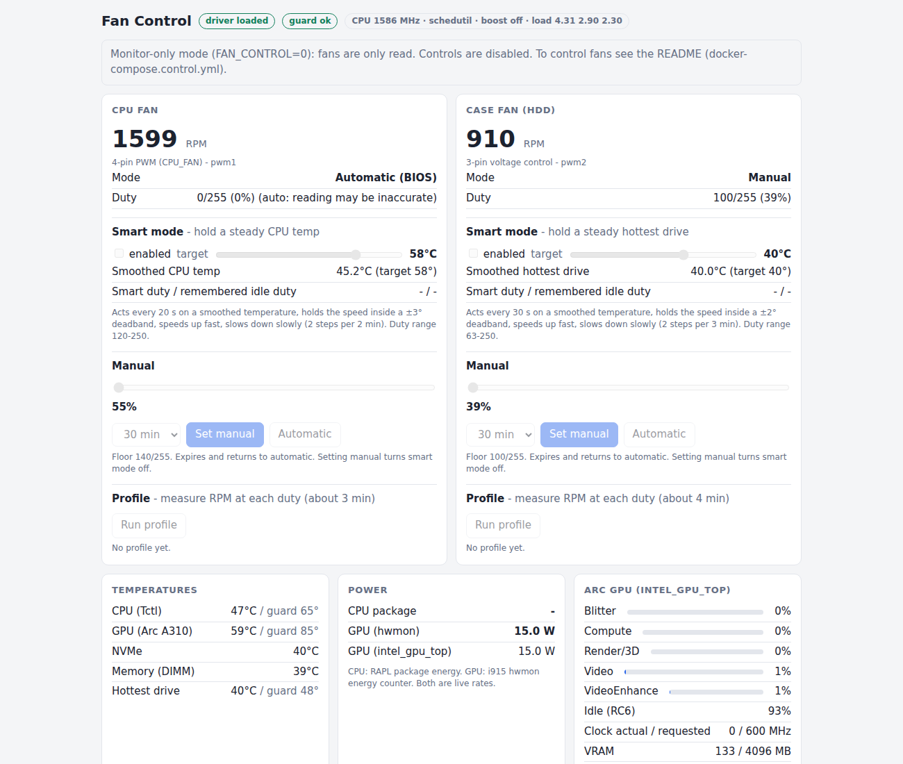
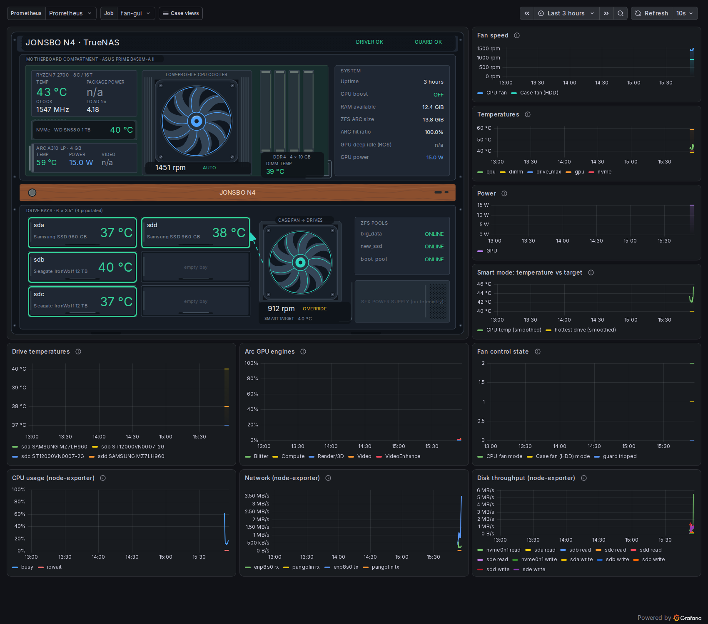

# Your NAS, alive in Grafana

> **AI disclosure:** this project was built with the assistance of AI tools: the dashboard builder tool, the animations and images, the fan GUI and exporter code, and the documentation and README. I tested it on my own server and reviewed the results, but treat it as you would any new software: read what it does before you run it, especially the fan-control mode.

An animated Grafana dashboard that draws **your server as a live picture**: the fans spin at the speed they really run, components glow amber and red as they heat up, drive trays blink with disk activity, and every temperature, power and ZFS value sits on the part it belongs to. One `docker compose up` gives you the exporters, Prometheus and Grafana with everything already imported.

<p align="center">
  
</p>

<p align="center"><sub>The animation above is the built-in <b>demo mode</b> (synthetic data, a 20 second idle → load → cool-down loop) so you can see the hot states. The photos below are the real server.</sub></p>

**Contents**

- [Try it in one minute (no hardware needed)](#try-it-in-one-minute-no-hardware-needed)
- [Gallery](#gallery)
- [My setup](#my-setup)
- [Set it up yourself, step by step](#set-it-up-yourself-step-by-step)
- [Fan control (optional, ITE chips only)](#fan-control-optional-ite-chips-only)
- [What works on which hardware](#what-works-on-which-hardware)
- [What is in the stack](#what-is-in-the-stack)
- [Make it yours](#make-it-yours)
- [Draw your own case (prompt template)](#draw-your-own-case-prompt-template)
- [How the animation works](#how-the-animation-works)
- [Security](#security)
- [Troubleshooting](#troubleshooting)
- [Repo layout](#repo-layout)
- [Status and honesty](#status-and-honesty)

## Try it in one minute (no hardware needed)

```bash
git clone https://github.com/<your-user>/<this-repo>.git && cd <this-repo>
docker compose -f docker-compose.demo.yml up -d
```

Open <http://localhost:3000> (no login needed to look around). Fans speed up and blur, the CPU cooler, GPU, memory and drive trays glow amber then red, the drive LEDs blink, and the numbers follow along. Stop it with `docker compose -f docker-compose.demo.yml down -v`. Everything in the demo is made up.

## Gallery

| | |
|---|---|
|  |  |
| **The real server** (isometric view, normal idle temperatures) | **Demo at peak load**: hot cooler, GPU riser and drive trays, blurred fans |
|  |  |
| **Flat blueprint view** (bigger readouts) | **Light theme** (every view comes in dark and light) |
|  |  |
| **Heat glows** on the real data with the limits lowered | **The small web GUI** (here in monitor-only mode) |

## My setup

I built this for my own home server, a small TrueNAS box in a Jonsbo N4. I wanted to *see* temperatures and fan speeds at a glance, and to keep the fans quiet without letting the drives get hot. Here is exactly what it runs on, so you can compare with yours:

| Part | What I use |
|---|---|
| Case | Jonsbo N4 (six hot-swap 3.5" bays, micro-ATX, SFX power supply) |
| Motherboard | ASUS PRIME B450M-A II (micro-ATX, AMD B450) |
| CPU | AMD Ryzen 7 2700, 8 cores / 16 threads, low-profile air cooler with a 4-pin PWM fan; boost switched off to keep it cool and quiet |
| Memory | 40 GB DDR4 (8 + 8 + 8 + 16 GB, mixed Corsair kits, running at 2133 MT/s) |
| GPU | ASRock Intel Arc A310 Low Profile 4 GB, used for hardware video decoding (Frigate) |
| Storage | 2 × Seagate IronWolf 12 TB (ZFS mirror `big_data`), 2 × Samsung 960 GB SSD (ZFS mirror `new_ssd`), WD Blue SN580 1 TB NVMe, 256 GB Samsung NVMe in a USB enclosure as the boot drive |
| Fans | CPU cooler fan (4-pin PWM) and one 3-pin case fan blowing across the drives |
| Fan chip | ITE IT8655E Super I/O (the chip that lets Linux read and set the fan speeds) |
| OS | TrueNAS SCALE 27.0.0-RC.1 (Linux 6.18), Docker 29, Docker Compose 2.40 |
| Software on it | media and camera apps in containers, plus this stack |

**Why a Jonsbo N4?** It has an open, mesh-sided frame, so how the fans move the air matters. The two fans I can steer are the CPU cooler fan and the case fan that blows over the drives, and those are the two fans on the picture.

The drawings in this repo are of the Jonsbo N4. Everything else (the data collection, the dashboards, the animations) works on any Linux machine; you simply get the Jonsbo picture. See "Make it yours" for what to change.

## Set it up yourself, step by step

You need a Linux machine you can SSH into (a NAS, a mini PC, a Raspberry Pi 5 ... anything with Docker). Nothing is installed on the host itself; everything runs in containers.

**Step 1: check the basics**
- Docker with Compose v2.20 or newer: `docker compose version`.
- Optional but recommended, so the drive temperatures show up: `sudo modprobe drivetemp`.
- On TrueNAS SCALE use an SSH shell as root (the Apps page does not show stacks started by hand, and that is fine).

**Step 2: get the code**
```bash
git clone https://github.com/<your-user>/<this-repo>.git
cd <this-repo>
```

**Step 3: choose two passwords**
```bash
cp .env.example .env
nano .env        # set FAN_GUI_PASSWORD and GRAFANA_PASSWORD to long random strings
```
No Intel GPU? Delete the line `COMPOSE_PROFILES=intel-gpu` in `.env`.

**Step 4: start it**
```bash
docker compose up -d --build
```
The first start downloads a few images and builds the small web app; give it a couple of minutes.

**Step 5: open Grafana**
Go to `http://<your-machine>:3000`, log in as `admin` with your `GRAFANA_PASSWORD`. The isometric case view opens as the home dashboard. The folder **TrueNAS** has all four variants (isometric or flat, dark or light). Numbers appear within about a minute and the history charts fill up over time.

**Step 6: tell it about your drives and pools (optional, 2 minutes)**
The picture shows four drives and three ZFS pools named like mine. If yours are different, copy `monitoring/grafana/config.example.json` to `config.json`, put your drives in (the short device name like `sda`, a caption, and `ssd` or `hdd`) and your pool names, then:
```bash
python3 monitoring/grafana/build_dashboard.py
docker compose restart grafana
```
List your drives with `lsblk -d -o NAME,MODEL,SIZE`.

**Step 7: add the extras you want (all optional)**
- **CPU power in watts:** `docker compose -f docker-compose.yml -f docker-compose.power.yml up -d` (needs a privileged container because Docker hides the power counters; the app still only reads).
- **Intel GPU details:** already included through the `intel-gpu` profile from step 3.
- **Fan control:** see the next section. Skip it unless you have an ITE fan chip and want it.

**Step 8: already have Prometheus and Grafana?**
Skip the bundled ones. Scrape the `fan-gui` service and node-exporter with `monitoring/prometheus.yml` (or `monitoring/config.alloy` for Grafana Alloy) and import the JSON files from `monitoring/grafana/`. Details in `monitoring/grafana/README.md`.

**Something shows n/a?** That just means your machine does not have that sensor or you have not enabled that extra: see the table further down.

### What the default install is allowed to do

The default is **monitor-only**: it never writes to your fans, and no container runs privileged. You can look around safely first and decide about control later.

## Fan control (optional, ITE chips only)

The same small web GUI (port 18765) can hold a steady temperature (**smart mode**), set a speed by hand (**manual**), and measure RPM at each speed (**profile**). I built it for the ITE IT8655E with the out-of-tree [`it87`](https://github.com/frankcrawford/it87) driver; other chips are monitor-only.

1. **Load the fan driver** for your running kernel. It builds in a container, nothing is installed on the host: `./it87/build-it87.sh ./it87/out && insmod ./it87/out/it87.ko`. Make it load at boot (on TrueNAS: System > Advanced > Init/Shutdown Scripts > Add, type Command, when Post Init). After a kernel update, rebuild it.
2. **Start with the control override:** `docker compose -f docker-compose.yml -f docker-compose.control.yml up -d`.
3. **Check the fan map** in `fan-gui/app.py` (`FANS`, `SMART`): on my board fan1 = CPU fan (4-pin, `pwm1`), fan2 = case fan (3-pin, `pwm2`). The duty limits are what I measured on my machine, so **measure yours** with the profile button before trusting smart mode, and try it with the case open the first time.

Safety built in: the BIOS curve is the safe state and every stop, expiry or guard trip returns to it; manual speeds have a floor and expire after 30 minutes; a thermal guard (CPU 65, drive 48, GPU 85 °C) forces everything back to automatic; a fan that reads under 250 RPM while we drive it goes back to automatic; stopping the container restores automatic. The maximum duty is 250 because 255 makes the driver give up control. Emergency:
```bash
H=$(grep -l '^it8655$' /sys/class/hwmon/hwmon*/name | xargs dirname)
echo 2 > $H/pwm1_enable; echo 2 > $H/pwm2_enable    # back to the BIOS curve
```
Control writes to hardware registers. `FAN_CONTROL_NOTES.md` has what I tested and the one thing that went wrong (a restore script in a no-exec `/tmp`).

## What works on which hardware

A missing metric shows **n/a** on the picture instead of breaking it.

| Feature | Needs | Without it |
|---|---|---|
| Fan RPM and mode | a hwmon driver with `fanN_input` (set `FAN_HWMON_PREFIX`, default `it8`) | n/a |
| CPU temperature | `k10temp` (AMD) or `coretemp` (Intel) | n/a |
| Drive temperatures | the `drivetemp` kernel module | n/a |
| NVMe / memory temperature | `nvme` / `jc42` hwmon drivers | n/a |
| ZFS pools and cache | ZFS on the host | n/a |
| CPU power | RAPL **and** a privileged container (`docker-compose.power.yml`) | n/a |
| GPU temperature and power | Intel GPU on `i915` / `xe` | n/a |
| GPU engines, idle, VRAM | the optional `intel-gpu-exporter` | n/a |
| Drive LEDs, CPU / network / disk panels | `node-exporter` (included) | LEDs dark, panels empty |
| Fan **control** | ITE chip + `it87` driver + `docker-compose.control.yml` | monitor-only |

<p align="center"><br><sub>The flat view with the GPU exporter deliberately stopped: the GPU values read <b>n/a</b>, everything else keeps working.</sub></p>

## What is in the stack

| Service | Port | Purpose |
|---|---|---|
| `grafana` | 3000 | the dashboards (datasource and four dashboards come pre-installed) |
| `prometheus` | 9090 (local only) | stores 30 days of metrics, alert rules in `monitoring/alerts.yml` |
| `fan-gui` | 18765 | exporter and small web UI: fans, temperatures, power, ZFS, GPU |
| `node-exporter` | 9100 | CPU, network, disks, drive LEDs |
| `intel-gpu-exporter` (optional) | internal | Intel GPU engines, power, RC6, VRAM |

| Compose file | Use |
|---|---|
| `docker-compose.yml` | the whole stack, monitor-only (default) |
| `docker-compose.demo.yml` | the demo with synthetic data, no hardware |
| `docker-compose.power.yml` | add CPU power readings (privileged, still read-only) |
| `docker-compose.control.yml` | enable fan control (privileged, `FAN_CONTROL=1`) |
| `fan-gui/docker-compose.yml` | the fan GUI alone (host network, control on), as I run it |

## Make it yours

- **Drives and job names:** `monitoring/grafana/config.example.json` (step 6).
- **A different case:** the pictures are Jonsbo N4 drawings, but you can have an AI illustration agent draw yours. See "Draw your own case" right below.
- **A different fan chip or fan labels:** `FAN_HWMON_PREFIX` picks the chip; names and limits are in `fan-gui/app.py`.
- **Labels and ZFS pool names on the pictures:** `labels` and `pools` in `monitoring/grafana/config.json` (see `config.example.json`).
- **Colours, thresholds, animation speed:** the top of `monitoring/grafana/build_dashboard.py`.

## Draw your own case (prompt template)

Don't own a Jonsbo N4? Everything except the pictures works on any machine, and the pictures are replaceable. **[`docs/ARTWORK_PROMPT_TEMPLATE.md`](docs/ARTWORK_PROMPT_TEMPLATE.md)** is a fill-in prompt for an AI illustration agent: a short sheet about your case (model, fans, drive bays, GPU, ...), ready-to-paste prompts for three levels of effort, and a follow-up prompt that adds heat glows, airflow, LEDs and a light theme. It is the same approach that produced the Jonsbo drawings in this repo.

1. Fill in the sheet, attach 3 or 4 photos of your case, paste the prompt into your AI assistant.
2. Check what it returns: `python3 tools/audit_artwork.py ~/my-case-artwork` (no scripts, text or external references; the files meet the dashboard's rules; it tells you which dashboard views the artwork can build).
3. Put the folder in `monitoring/grafana/`, set `"assets_dir"` in `monitoring/grafana/config.json`, run `python3 monitoring/grafana/build_dashboard.py`, and watch your case in the demo (`docker compose -f docker-compose.demo.yml up -d`).

The generator copes with other cases: fewer fans or drive bays, no GPU, composite-only artwork, your own labels and ZFS pool names. Whatever the artwork lacks is skipped, and a view it cannot build is skipped with a message. I tested this with a deliberately reduced artwork set (one fan, two drives, one pool) next to the Jonsbo one.

## How the animation works

Grafana's Canvas panel cannot rotate something from data, so each fan is an animated SVG chosen by RPM through a value mapping: one per 150 RPM step, spinning once a second at 1800 RPM, with a motion-blur version above that. Heat glows, airflow lines and drive LEDs are overlays picked the same way from temperatures, fan RPM and disk busy time. The artwork is embedded in the dashboard JSON, so there is nothing to host. More in `monitoring/grafana/README.md`.

## Security

- No HTTPS and basic auth only: keep it on a trusted network or put a TLS reverse proxy in front. `BIND_ADDR=127.0.0.1` in `.env` listens on this machine only.
- Both passwords are required, the stack refuses to start without them. Never commit `.env`.
- `node-exporter` uses the host network and listens on 9100; firewall it if the machine is exposed.
- `intel-gpu-exporter` needs the host PID namespace and `SYS_PTRACE`. It is a small third-party project (MIT, few commits, no releases): review it or skip the profile.
- The power and control overrides make `fan-gui` privileged. The app is read-only unless `FAN_CONTROL=1`, but a privileged container is a bigger decision.
- The demo has no passwords by design and listens on localhost only.

## Troubleshooting

- **A value reads n/a:** check the table above. `curl -u admin:PASSWORD http://localhost:18765/metrics` shows what the exporter sees.
- **No fans found:** `grep -H . /sys/class/hwmon/hwmon*/name`, then set `FAN_HWMON_PREFIX` to the start of your fan chip's name (`nct` for Nuvoton). Without a hwmon fan driver the fans cannot be read.
- **No drive temperatures:** `sudo modprobe drivetemp`.
- **Prometheus target `fan-gui` shows 401:** you changed the password in `.env`; run `docker compose up -d` again.
- **The picture looks stretched:** the case panel is designed for about 1100 × 750 px (16 of 24 columns on a 1700 to 1900 px screen).
- **CPU watts n/a:** expected in the default install, see `docker-compose.power.yml`.
- **After a kernel or TrueNAS update the fan driver is gone:** the fans are then simply on the BIOS curve. Rebuild with `it87/build-it87.sh`.

## Repo layout

| Path | Purpose |
|---|---|
| `docker-compose*.yml`, `.env.example`, `stack/` | the stack and its Prometheus / Grafana provisioning |
| `demo/` | the synthetic-data exporter behind the demo |
| `fan-gui/` | exporter + web GUI + fan control (Python standard library only) |
| `it87/` | builds the fan driver for the running kernel |
| `monitoring/` | Prometheus config and alerts, Alloy config, and `grafana/` (generator, dashboards, artwork) |
| `tools/audit_artwork.py` | checks artwork from an illustration agent before you use it |
| `docs/` | the animation, screenshots and `ARTWORK_PROMPT_TEMPLATE.md` |
| `FAN_CONTROL_NOTES.md` | the full record: tests, gotchas, research, design |

## Status and honesty

Tested on the one machine described above: the whole stack, all four dashboards on Grafana 13.3.1, the demo, monitor-only mode running next to a live controller, and the view with the GPU exporter stopped. **Not tested:** other hardware, other kernels, Grafana older than 10, small screens, fan control on any chip but the IT8655E, Docker Desktop (the stack needs a Linux host with hwmon access), and a fresh `git clone` on a clean machine. The drive LEDs show disk activity from node-exporter. The artwork was produced by an AI illustration agent from written briefs and audited before use (no scripts, text or external references in any SVG). The animation at the top is demo data, not my server.

Built with [Grafana](https://grafana.com), [Prometheus](https://prometheus.io), [node-exporter](https://github.com/prometheus/node_exporter), [intel-gpu-exporter](https://github.com/lfventura/intel-gpu-exporter) (MIT) and the [it87 fork](https://github.com/frankcrawford/it87).

No licence file has been chosen yet, so others have no explicit permission to reuse this. Add the licence you want before publishing.
