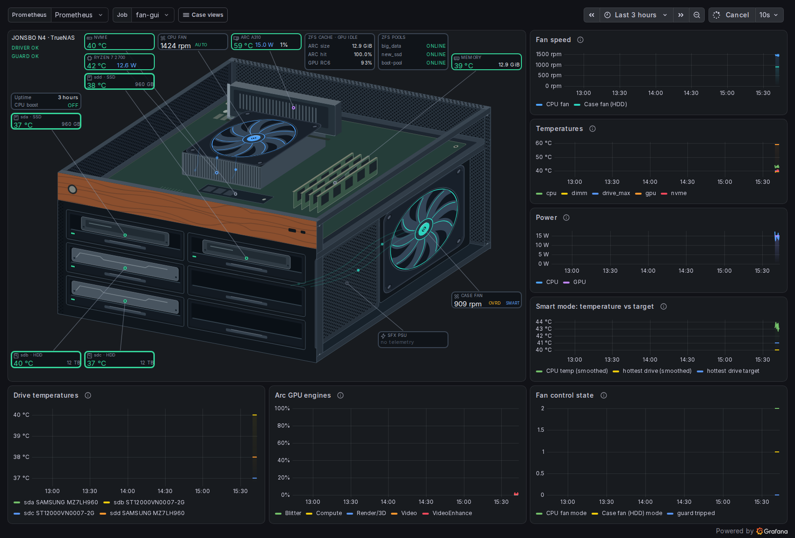
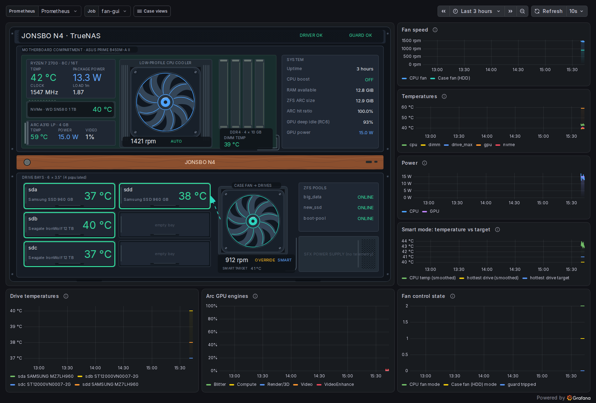
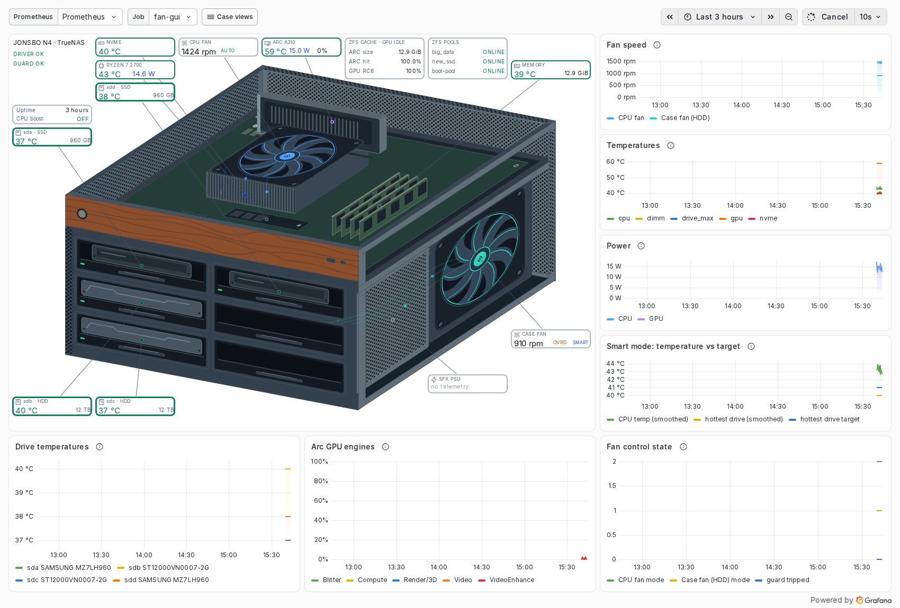
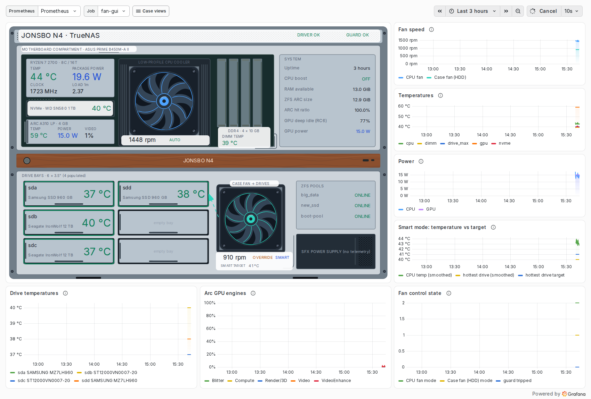

# Grafana dashboards: TrueNAS Case & Fans (Jonsbo N4)

Four ready-to-import dashboards (two views, dark and light) built around a Canvas panel: **animated fans** that spin at a speed following the measured RPM, live CPU / GPU / NVMe / DIMM / drive temperatures, power, ZFS pool state, fan modes, heat glows, airflow and drive-present LEDs. Seven chart panels sit beside and below the canvas.

| File | View | Preview |
|---|---|---|
| `fan-control-isometric.json` | isometric 3D-style Jonsbo N4, layered artwork (dark) |  |
| `fan-control-dashboard.json` | flat blueprint, larger readouts (dark) |  |
| `fan-control-isometric-light.json` | isometric, single-drawing light version |  |
| `fan-control-dashboard-light.json` | flat blueprint, light version |  |

All four link to each other through the "Case views" dropdown (same variables and time range). `preview_heat_glow.png` shows the heat glows with the temperature limits deliberately lowered so they trigger.

## Requirements

- Prometheus (or Mimir / Grafana Cloud) scraping the fan-gui `/metrics` (job `fan-gui`) and **node-exporter** (job `node`; used for the tray LEDs and the three bottom panels). The all-in-one stack in the repo root does all of this and provisions these dashboards; otherwise see `../prometheus.yml` or `../config.alloy`.
- Grafana 10 or newer. Built and rendered on **Grafana 13.3.1** (classic JSON; Grafana migrates it to its newer dashboard model on open).
- Nothing else: no plugins and no hosted images (all artwork is embedded in the JSON).

## Import

1. Grafana > Dashboards > New > Import > upload a JSON file (any or all of the four).
2. Pick your Prometheus datasource (the `Prometheus` variable at the top; it selects the first Prometheus datasource automatically).
3. If your scrape job is not called `fan-gui`, change the `Job` variable.

UIDs: `truenas-case-fans-iso`, `truenas-case-fans`, `truenas-case-fans-iso-light`, `truenas-case-fans-light`. Re-importing the same UID overwrites. For file provisioning, drop the JSON into a normal dashboards folder provider.

## What moves and what it is driven by

| Visual | Driven by |
|---|---|
| Fan spin | RPM: one animated SVG per 150 RPM step; spin period 1800 / RPM seconds (1800 RPM = one turn per second); below 100 RPM the fan is drawn stopped; at and above 1800 RPM a motion-blur version is used |
| Heat glow on CPU cooler, GPU riser, NVMe, DIMMs, trays 1-4 (isometric) | temperature crossing a warm / hot limit (CPU 52/60, GPU 70/80, NVMe 55/65, DIMM 50/60, drives 42/45 C). Nothing is drawn below the warm limit (`SHOW_OK_GLOW` in the script turns on a green pulse) |
| Airflow streamlines (isometric) | fan RPM: animated at 300 RPM or more, dim and static below |
| Tray LEDs (isometric) | disk busy time from node-exporter (`node_disk_io_time_seconds_total`): lit when the disk was more than 1 % busy over the rate window, dark otherwise; absent without node-exporter |
| Badge colours, numbers | live metrics, coloured by the same thresholds as the thermal guard |
| Badge `AUTO` / `OVRD` / `FULL` + `SMART` | fan mode (BIOS curve / override / full speed) and whether the smart controller is on |

The fan speed is proportional but stepped, and scaled so it is readable on screen (a real 1500 RPM would look like a blur). The number next to each fan is the real RPM.

## How it works (for changing it)

Canvas cannot rotate an element from data, so images are chosen with **value mappings with an icon** on a field: Grafana turns the mapped icon into the element's image URL. Every SVG is therefore a `data:image/svg+xml;utf8,...` URI; the literal `http://` in each `xmlns` must stay (Grafana recognises an absolute URL by `:/`), and the generator keeps `:` and `/` unescaped.

- **Isometric (dark):** layers stacked in the artwork manifest's z-order: base (root background), components, heat glows, fans, empty trays, drives, tray glows, front panel, mesh, airflow, LEDs, leader lines, then badges. Fans sit below the front panel and mesh, so they are occluded correctly.
- **Isometric (light):** the artwork supplies a single light drawing, so the fans, glows, airflow and LEDs are drawn on top of it.
- **Blueprint:** `case_background*.svg` as the backdrop; fans on top; "chips" (semi-opaque cards) keep text readable where it crosses dark parts of the drawing.
- Badge positions, anchors and the leader lines come from `assets/manifest.json` (the projected geometry of every component); the leader-line overlay is generated by the script.
- **Tray order:** tray 1-3 are the left column top to bottom, 4-6 the right. `DRIVES` in the script maps `dev` labels to trays 1-4: sda SSD, sdb HDD, sdc HDD, sdd SSD, matching the drawing (SSD sleds in 1 and 4, 3.5" HDDs in 2 and 3, 5 and 6 empty). Device letters can change after a reboot and the captions are written by hand, so check them.

## Layout and scaling

Every element uses percentage ("scale") constraints against a 1100 x 742 design and the artwork is stretched (`fill`), so drawing and overlays stay aligned as the panel resizes (fonts stay fixed). The canvas panel is 16 columns by 20 rows (about 1110 x 750 px on a 1700-1900 px screen), which matches the design's aspect ratio; other widths stretch slightly. Grafana's zoom-to-fit option needs a feature flag and is not used. Inline editing and pan/zoom are off.

## Customising

Everything comes from `build_dashboard.py`; edit and re-run, then re-import. Drive names and Prometheus job names can be set without editing the script: copy `config.example.json` to `config.json`.

```bash
python3 build_dashboard.py     # writes the four JSON files
```

- `DRIVES`, `DEFAULT_JOB`, `FAN_ACCENT`, `RPM_STEP`, `SPIN_RPM_PER_TURN_SECOND` (animation speed), `BLUR_FROM_RPM`, `SHOW_OK_GLOW`, `AIRFLOW_ON_RPM`, `LIMITS` (glow limits), `THEMES` (colours).
- Artwork and its rules: `assets/README.md`.

## Panels

| Panel | Shows |
|---|---|
| Case view (canvas) | the animated case with live values |
| Fan speed | RPM of both fans |
| Temperatures | CPU, GPU, NVMe, DIMM, hottest drive |
| Power | CPU and GPU watts |
| Smart mode: temperature vs target | smoothed temperature against its target (only while smart mode is on) |
| Drive temperatures | every drive |
| Arc GPU engines | intel_gpu_top engine utilisation |
| Fan control state | fan mode (2 auto, 1 override, 0 full) and guard |
| CPU usage / Network / Disk throughput | node-exporter (CPU busy and iowait, physical NICs, physical disks) |

## Verified

All four dashboards were imported into Grafana 13.3.1 against a live Prometheus scraping the running fan-gui and rendered in headless Chromium (the light ones with Grafana's light theme): no console errors, canvas, value-mapped fan images, colours, mappings, leader lines and all seven charts appear. Screenshots a fraction of a second apart differ in the fan and airflow areas (animation running) in the isometric, isometric-light and flat views. The heat glows were verified with a scratch copy whose limits were lowered (`preview_heat_glow.png`). Not verified: older Grafana versions, small screens, the blur fan on screen (the CPU fan has not been above 1800 RPM during the tests), real hot temperatures, and Grafana Cloud.

## Demo copies

`demo/fan-control-isometric.json` and `demo/fan-control-dashboard.json` are the same dashboards with a 2 s refresh, used by `docker-compose.demo.yml` (synthetic data, see the repo root README). Every dashboard lists `1s ... 15m` in `timepicker.refresh_intervals`: Grafana silently ignores a refresh value that is not in that list. In the all-in-one stack the refresh stays at 10 s.

## Missing metrics

Every canvas query ends with `or on() vector(NaN)` and every field has a special value mapping, so a metric that does not exist (no Intel GPU exporter, no RAPL, no node-exporter) shows **n/a** instead of "Field not found". Verified by stopping the GPU exporter in the all-in-one stack.

## Known quirks

- A new Prometheus shows chart history only at the right edge until it has data.
- `intel_gpu_top` can report RC6 above 100 %; the dashboard clamps it to 100.
- The ARC hit ratio is an instant `rate()` over `$__rate_interval`; it reads 100 % on a quiet system.
- The leader lines cross the drawing (the manifest places badges outside the case silhouette); they are thin and semi-transparent.
- The light blueprint keeps the dark PCB and heatsink from the artwork; text over them sits on chips.
